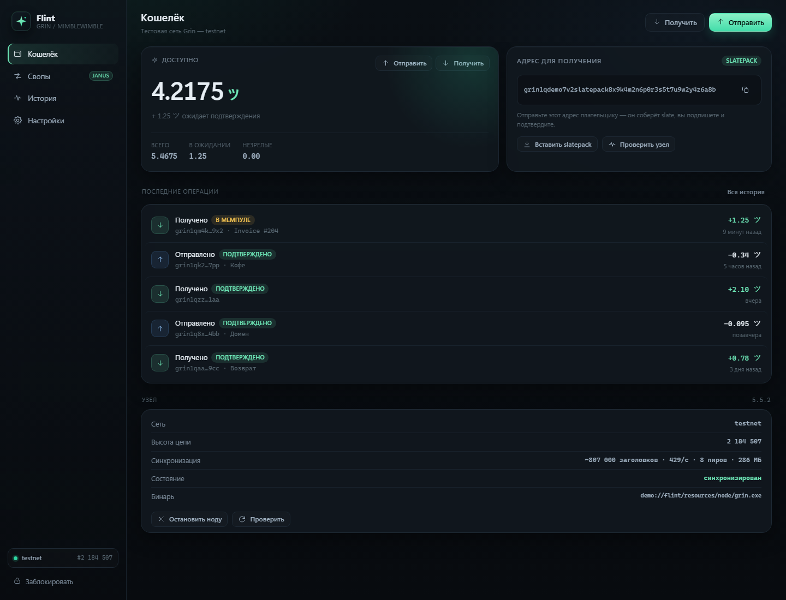
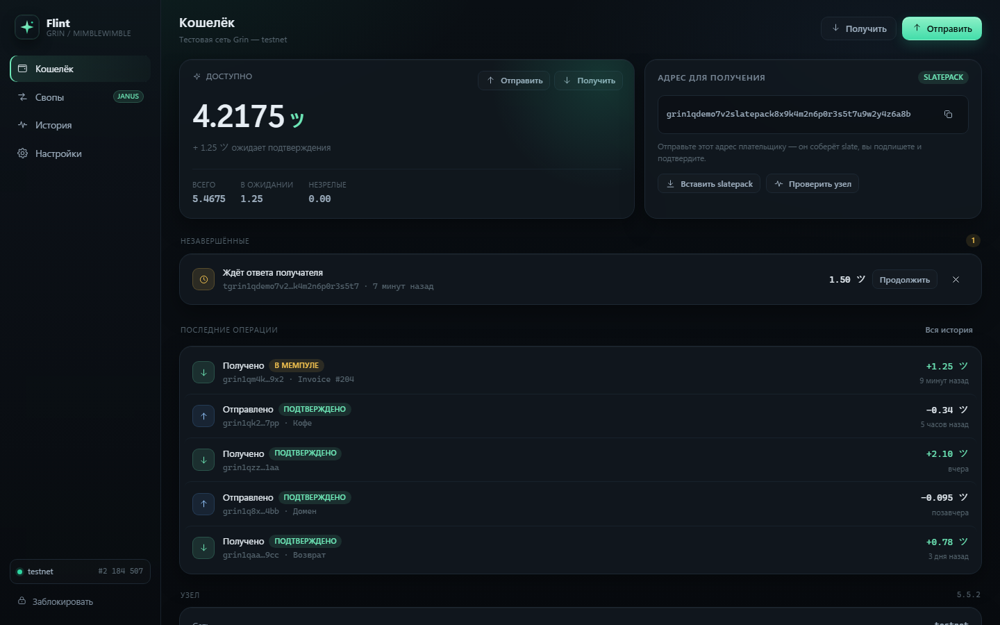
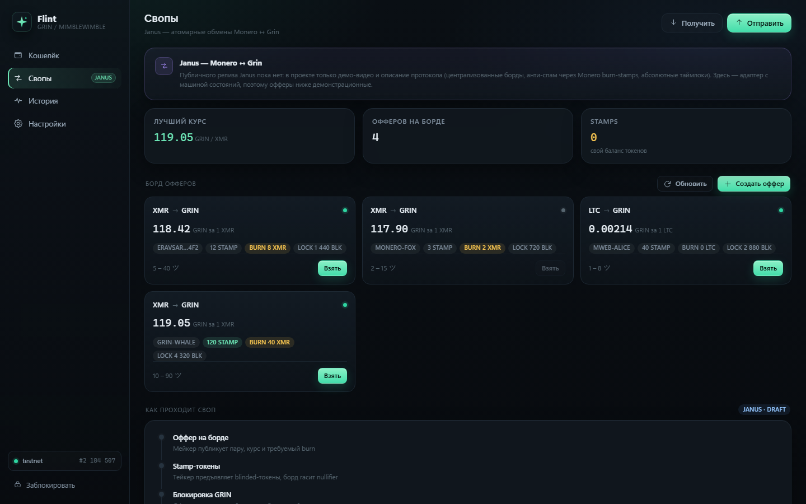

# Flint — кошелёк Grin

Текущее состояние — **0.1.69**. Честный отчёт о том, что проверено, а что нет:
[docs/status/STATUS.md](docs/status/STATUS.md). Проект **не аудирован** и не предназначен для
реальных средств.

Десктопный кошелёк для **Grin (Mimblewimble)** на тестовой сети, плюс слой атомарных
свопов **Janus (Monero ↔ Grin)**.

Ядро — Rust. Криптография и работа со slate-ами не самописные: используются официальные
крейты Grin (`grin_wallet_libwallet 5.5`, `grin_wallet_api`, `grin_wallet_impls`,
`grin_keychain`, `grin_core`). Своей ноды у проекта нет и не нужно: приложение управляет
**официальной Rust-нодой `grin` v5.5.2** как дочерним процессом. Интерфейс —
нативный Slint 1.18 (`crates/slint-ui`); Tauri удалён в 0.1.69.

> **DEV BUILD — не аудирован, не для реальных средств.** Чек-лист mainnet: [docs/status/MAINNET_READINESS.md](docs/status/MAINNET_READINESS.md). Нода: [docs/architecture/NODE_ARCHITECTURE.md](docs/architecture/NODE_ARCHITECTURE.md). Backup/restore: [docs/operations/BACKUP.md](docs/operations/BACKUP.md). Что действительно
> проверено, а что сломано: [docs/status/STATUS.md](docs/status/STATUS.md). Порядок работ:
> [docs/status/ROADMAP.md](docs/status/ROADMAP.md).

## Лицензия

Flint распространяется по **GNU General Public License v3.0 only**
(`GPL-3.0-only`). Полный текст — [COPYING](COPYING). Исходники релиза —
`lastver/Flint-<version>-source.zip`; для сборки нужны `Cargo.lock` и
`cargo vendor` (или сеть). MSRV — **Rust 1.92** из-за Slint 1.18.1.

Slint 1.18.1 — единственный UI (`crates/slint-ui`, общий `flint-runtime`):
lock screen, `WalletService`, RPC, Tor и messenger. Slint лицензируется под
`GPL-3.0-only OR LicenseRef-Slint-Royalty-free-2.0 OR
LicenseRef-Slint-Software-3.0`; проект использует GPLv3-вариант. Это означает,
что распространяемая сборка Flint целиком должна быть GPLv3-совместимой.
Source archive содержит `vendor/slint*`.



## Дизайн

Палитра, типографика, радиусы, движение и правила адаптивности зафиксированы в
[DESIGN.md](DESIGN.md). Актуальный UI — Slint: токены в `Theme` (`ui/theme.slint`),
мята — единственный акцент, суммы моноширинным, бренд — знак «Складка»
(`ui/assets/flint-mark.svg`). Старые CSS-термины (`:root`, `.gsym`) к текущему
приложению не относятся.


---

## Что работает

| Область | Состояние |
|---|---|
| Создание кошелька, seed-фраза (24 слова), пароль, блокировка/разблокировка | ✅ проверено тестами |
| Несколько профилей с разными seed в одном окне; активен один профиль | ✅ embedded/RPC regression и живые сценарии; ручная UI-приёмка открыта |
| Выбор каталога данных ноды и кошельков с применением после перезапуска | ✅ regression + debug-preview; файлы не копируются автоматически |
| Argon2id-конверт seed (`wallet.seed.v2`) для обоих бэкендов, миграция legacy, mainnet-гейт, ремонт | ✅ тесты, kill-дрилл M0–M5, адверсариальное ревью; внешнего аудита и обрыва питания нет |
| Официальная нода `grin` v5.5.2: авто-запуск, остановка, лог, высота цепи | ✅ тест старт/стоп + живая синхронизация |
| Нода: owner API | ✅ требует Basic-auth, секрет создаётся до старта; foreign API — read-only и открыт на loopback (0.1.47) |
| Переключение testnet ↔ mainnet (свои ключи, порты, каталоги) | ⚠️ код есть, но **mainnet запрещён** до внешних гейтов; реальные средства не используются |
| Slatepack-адрес (`tgrin1…`) | ✅ |
| Баланс, история транзакций, статус узла | ✅ живой testnet; статус — по фазе ноды |
| Отправка: `prepare` → slatepack → `finalize` | ✅ живой testnet и `transaction_lifecycle` на embedded/RPC |
| Приём: разбор slatepack → ответный slatepack → закрытие | ✅ живой testnet, идемпотентный повтор |
| Реальный encrypted slatepack через messenger + смена профилей без перезапуска | ✅ default → alice, 1 GRIN; скриншот `docs/assets/shots/flint-slatepack-real.png` |
| Авто-финализация slatepack от сохранённых контактов | ✅ UI-чекбокс, default off; фоновый inbox-опрос раз в 10 с и обработка всего батча armor; incoming response от alice автофинализирован на default (`ответ на отправку автофинализирован`); первый входящий на alice обработан фоновым таймером, в истории появился outgoing response; доставка этого response на default в фоновом прогоне не подтверждена |
| Незавершённые slate: продолжить | ✅ крэш-тесты и ручной прогон |
| Отмена незавершённого slate | ✅ `Owner::cancel_tx`; баланс после cancel и restart проверен |
| Восстановление из seed-фразы | ✅ полный chain-scan, reopen и сверка адреса/баланса отдельным backend-оракулом |
| Нативный Slint-интерфейс, без WebView2 | ✅ `flint-slint` + `flint-selftest` |
| Журнал состояний и повторная публикация подписанной транзакции | ✅ regression и живой crash/recovery без повторной подписи |
| Статус ноды: фазы и запрет отправки до «готова» | ✅ юнит-тесты + живой прогон на синхронизирующейся ноде |
| Janus: офферы, машина состояний, таймлоки, возврат | ✅ тесты; борд демонстрационный |
| Реальный Monero-лег свопа (adaptor-подписи, burn-токены, клиент борда) | ❌ нет публичного протокола Janus |
| Мессенджер M1/M2/M3: конверт, gateway, UI, прямой onion, relay, адресная книга, Tor-мосты | ✅ SDK + gateway + история + живой direct-обмен; `flint-relay`, signed ack, PoW, P2P-лимиты, block/mute, шифрованные контакты, obfs4/snowflake/webtunnel (0.1.69) |
| QR-код адреса | ✅ при получении и в send-диалоге |

Незавершённые slate переживают перезапуск: запись лежит в
`<data>/<network>/pending/<uuid>.json`, её можно продолжить или отменить. Отмена
идёт через кошелёк Grin (иначе входы остались бы заблокированными) и требует
запущенной ноды. Входящий slate отменить нельзя: отправитель мог уже опубликовать
транзакцию.



## Карта модулей

```
crates/slint-ui         единственный UI: `flint-slint` на Slint 1.18
crates/runtime          `WalletRuntime`: RPC, Tor, messenger и ключ истории
tools/package-slint.ps1 portable preview + selftest
tools/fetch-node.ps1    загрузка официальной ноды с проверкой SHA256
tools/run-testnet-node.ps1  долгоживущая testnet-нода для живых гейтов
tools/run-live-testnet.ps1  живой сценарий перевода (с предохранителями)
tools/semantic-search.ps1  смысловой поиск по `crates/` через локальные embeddings LM Studio
docs/operations/RELAY.md              standalone relay: запуск, Tor, API, ack
docs/operations/TOR_BRIDGES.md        obfs4/snowflake/webtunnel-мосты для блокировок Tor
docs/architecture/BACKENDS.md           границы embedded/grin-wallet и гейт удаления embedded
docs/ui/SLINT.md              Slint UI, GPL, MSRV 1.92
docs/historical/TAURI_REMOVAL.md      журнал удаления Tauri и backup
docs/README.md          индекс документации: статус, безопасность, эксплуатация, история
resources/node/grin.exe официальная нода Grin v5.5.2 (не в git)
crates/janus            свопы: офферы, борд, stamp-авторитет, машина состояний
crates/core             кошелёк + управление нодой: жизненный цикл, slate-ы, баланс
archive/flint-agent     (не собирается) ранее написанный LLM-ассистент
```

### `flint-core` — кошелёк

| Модуль | Ответственность |
|---|---|
| `config.rs` | пути данных (`%LOCALAPPDATA%\Flint` или `FLINT_DATA_DIR`), `settings.json`, изоляция сетей |
| `node.rs` | `NodeManager`: поиск `grin.exe`, генерация конфига, запуск/остановка, ожидание RPC, лог, порты testnet 13413 / mainnet 3413 |
| `service.rs` | `WalletService`: create/open/lock, `prepare_send`/`finalize_send`, `prepare_receive`/`finalize_receive`, `summary`, `activity`, `list_pending`, `node_info` |
| `model.rs` | DTO для UI: суммы в нанограммах **строками** (не влезают в `f64`/`u64` JS) |
| `error.rs` | типизированные ошибки на русском |

Ключевые решения:

* **Chain type** выставляется на каждом входе (`set_local_chain_type` + `init_global_chain_type`):
  Grin держит сеть в thread-local, а кошелёк вызывается из пула потоков.
* **Незавершённые slate** сохраняются в `<data>/<network>/pending/<slate_id>.json`
  (`VersionedSlate`) и переживают перезапуск; в UI их можно продолжить или отменить.
  Отмена идёт через `Owner::cancel_tx`; восстановление `spendable` и `locked` после
  cancel проверено в живом transaction lifecycle и повторно после restart.
* **Сеть изолирована каталогом**: `testnet/wallet` и `mainnet/wallet` не пересекаются.
* Пароль не хранится. Кошельки обоих бэкендов (встроенного и RPC) защищены
  Argon2id-конвертом `wallet.seed.v2` (64 МиБ / t=3 / p=4 → `CHACHA20_POLY1305`,
  AAD связывает все поля заголовка): `grin-wallet` получает временный seed с
  паролем из 256 случайных бит, поэтому его PBKDF2-100 не защищает пароль
  пользователя. Кошельки, созданные до 0.1.68, живут на upstream
  `PBKDF2_HMAC_SHA512`, **100 итераций**
  ([seed.rs:289](third_party/grin-wallet/impls/src/lifecycle/seed.rs#L289)) и
  мигрируются кнопкой «Включить Argon2id»; mainnet без конверта не открывается.
  Дизайн и ограничения — [docs/historical/ARGON2ID.md](docs/historical/ARGON2ID.md).

### `flint-janus` — свопы

| Модуль | Ответственность |
|---|---|
| `model.rs` | `Offer`, `Swap`, `SwapState`, `SwapEvent`, проверка переходов |
| `board.rs` | трейты `Board` и `StampAuthority` + локальные демо-реализации |
| `service.rs` | `JanusService`: выбор оффера, состояние, персист, `refundable(tip)`, демо-прогон |

Состояния: `Taken → StampsVerified → GrinLocked → SecretRevealed → Completed`,
плюс `Refunded` (только после абсолютного таймлока) и `Aborted` (только до блокировки).
`blocks_to_refund(tip)` отдаёт остаток блоков — по нему UI показывает дедлайн.

### `flint-runtime` — общая сессия

`WalletRuntime` владеет `WalletService`, RPC-процессом `grin-wallet`, Tor,
messenger/историей и ключом истории. Все методы блокирующие; UI вызывает их
из рабочего потока.

### `crates/slint-ui` — интерфейс

Slint 1.18: lock/create/restore, кошелёк, история, pending, свопы, настройки,
Tor (start/stop/мосты/лог) и messenger (отправка, входящие, контакты, blocked,
recovery). Live-статус ноды/скана раз в 2 с, прогресс скана, Theme-токены,
resizable от 900×760 и ScrollView. Headless-проверка — `flint-selftest` из
`flint-runtime`.

## Нода: официальный `grin` (Rust)

Свою ноду мы не пишем. Приложение берёт официальный релиз с GitHub
(`grin-v5.5.2-win-x86_64.zip`, SHA256 сверяется), кладёт в `resources/node/grin.exe`
и управляет им:

* первый запуск — генерирует `grin-server.toml` в `<data>/<network>/node/`;
* запускает `grin --testnet --no-tui server -c … run` без консольного окна;
* ждёт открытия RPC (testnet `127.0.0.1:13413`, mainnet `:3413`) и показывает высоту;
* останавливает процесс при выходе из приложения.

Кошелёк общается с нодой по её JSON-RPC `/v2/foreign` (`get_tip`, `get_version`, …) —
тот же протокол, которым пользуется официальный `grin-wallet`.

Проверено вживую: нода поднимается, подключается к тестовым пирам и качает заголовки.
Оговорка: тестовая цепь Grin — это несколько миллионов блоков; первая синхронизация занимает часы
и место на диске, баланс появится только после того, как нода догонит сеть.

## Janus: что это и почему «адаптер»

Публично о Janus известно немного: это **Monero ↔ Grin** атомарные свопы от `eravsar`
(анонс на форуме Grin, июль 2026). По состоянию на октябрь 2026 **репозитория и
спецификации нет**, автор обещает alpha. Из описания:

* централизованные **борды** — только для поиска пиров, на своп не влияют;
* анти-спам — **Monero proof-of-burn** + blinded-токены (stamp-авторитеты с базой nullifier-ов),
  альтернативы: Equi-X PoW или приватные офферы;
* на Grin-ноге — **абсолютные таймлоки**; также заявлены пары с MWEB (Litecoin).

Поэтому здесь не «интеграционный SDK» (его не существует), а **слой под протокол**:
машина состояний, учёт таймлоков и возвратов, модель офферов, абстракции борда и
stamp-авторитета. Когда Janus выйдет, заменяются две реализации трейтов (`Board`,
`StampAuthority`) и добавляется вторая нога свопа.

Что честно **не** сделано: адаптер-подписи, раскрытие секрета, реальный burn XMR и
клиент борда. Демо-своп проходит всю машину состояний локально и помечен как симуляция.



## Сети: testnet и mainnet

Переключение — Настройки → «Сеть» → `mainnet` → Сохранить → приложение перезапустится.
Порт узла подставляется сам (testnet 13413, mainnet 3413), флаг `--testnet` снимается.

* **Это разные кошельки.** `data/testnet` и `data/mainnet` не пересекаются: своя
  seed-фраза, пароль и история. Тестовую фразу в mainnet вставлять нельзя.
* **Mainnet — реальные деньги.** Seed-фраза = кошелёк, хранить офлайн.
* **Синхронизация mainnet тяжёлая**: больше блоков, больше диска, часы ожидания.
  Пока идёт — баланс нулевой, это нормально.
* Перезапуск обязателен: Grin хранит тип цепи глобально на процесс.

## Безопасность

* Нода — отдельный процесс grin.exe, запускается без консольного окна и живёт только пока открыто приложение.
* Сеть по умолчанию — **testnet**; mainnet проверялся только на уровне запуска ноды и адреса, реальные транзакции не отправлялись.
* Seed не покидает процесс; показывается один раз при создании.
* Пароль не сохраняется; без него кошелёк не отдаёт ни адрес, ни баланс.
* Сетевые соединения зависят от включённых функций: пиры Grin, выбранный RPC-узел,
  Tor, messenger и relay. Удалённый web-контент в нативный Slint UI не загружается.

## Запуск

Требуется: Rust (MSVC toolchain), Visual Studio Build Tools 2022. WebView2 больше
не нужен: UI нативный Slint.

```powershell
tools\fetch-node.ps1                     # один раз: официальная нода + проверка SHA256
cargo run -p flint-slint                # окно приложения (нужен интерактивный рабочий стол)
cargo run -p flint-runtime --bin flint-selftest  # headless-проверка связки
```

Нода запускается вместе с приложением (галочка в настройках) или кнопкой «Запустить ноду».
Если `grin.exe` не найден, кошелёк работает с внешним узлом по адресу из настроек.

### Портативная сборка

```powershell
pwsh -File tools/package-slint.ps1
# или весь гейт одной командой: fmt/check/tests/release selftest/SBOM/package
pwsh -File tools/release.ps1
# для денег: без сертификата команда ниже упадёт, а не выпустит UNSIGNED
pwsh -File tools/release.ps1 -RequireSigned -CertificateThumbprint <sha1>
```

Результат:

| Путь | Что это |
|---|---|
| `C:\DHW` | актуальное дерево исходников |
| `lastver/Flint-0.1.69-keyboard/` | **актуальный portable-пакет**; запускать `Flint.exe` |
| `lastver/BUILD-INFO.json` | манифест текущего пакета: версия, SHA-256, тесты, снимок |
| `lastver/Flint-0.1.69-source.zip` | исходники текущего пакета (GPL-совместимый архив) |
| `C:\Flint` | обновлённая вручную portable-копия; `data/` и `data1/` сохранены |
| `target/release/flint-slint.exe` | промежуточный Cargo-бинарь, не канонический пакет |
| `dist/` | рабочий вывод `tools/package-slint.ps1`, SBOM; старые данные не трогаются |
| `archive/` | старые сборки (`archV/`), логи, патчи и `selftest.json` |

Установленная копия `C:\Flint` **обновляется вручную**; 2026-10-28 в неё положены
текущие `Flint.exe`, `flint-selftest.exe`, `resources/` и `README.txt`. Каталоги
`data/` и `data1/` не перезаписывались; в `data1/` есть mainnet-данные. Старые
`lastver`-пакеты, zip/source и промежуточные `.bak` удалены; один rollback-exe
оставлен в текущем пакете.

> Tor входит в zip: `tor.exe` и `lyrebird.exe` (obfs4/snowflake/webtunnel).
> Строки мостов нужно один раз вставить в UI «Сеть и кошелёк»; автоматического
> получения мостов нет.

> Артефакты **не подписаны**: сертификат не передавался. `tools/release.ps1`
> умеет подписывать (`-CertificateThumbprint`), но без сертификата релиз
> остаётся dev-сборкой. Исходники и relay 0.1.68 в таблице не обновлялись.

> **Установщик удалён из релиза.** Ранние сборки ставили копию в
> `%LOCALAPPDATA%\Flint` с отдельным кошельком — это путало. Сейчас основной
> способ — portable-zip: данные лежат в `data\` рядом с exe. Если ранняя версия
> уже установлена, удалите `%LOCALAPPDATA%\Flint` и ярлык, **предварительно
> сохранив seed**, если в этом каталоге создавался кошелёк.

> **Хранение артефактов:** рабочие portable-zip создаются в `dist/`, затем копируются
> в `lastver/`. Новый debug-пакет сохранён отдельным именем; прежний release не удалён.

Внутри — exe со встроенным интерфейсом и **встроенной нодой**. По умолчанию данные лежат
в `data\` рядом с exe. В «Настройках» можно выбрать другой общий корень для ноды и всех
кошельков; изменение применяется после перезапуска, файлы автоматически не копируются.
Селектор `data-root.json` лежит рядом с portable exe. Инструкция — [DATA_ROOT.md](docs/operations/DATA_ROOT.md).
WebView2 не требуется.

Проверка без окна (≈10 секунд, поднимает и гасит ноду):

```powershell
flint-selftest.exe   # JSON в stdout
```

Отчёт: адрес, совпадение после переоткрытия, число слов seed, офферы, финальное
состояние свопа.

### Зависимости и офлайн-сборка

Крейты завендорены в `vendor/`, `.cargo/config.toml` включает `offline = true`.
Пересобрать вендор (нужна сеть):

```powershell
cargo vendor vendor
```

Если MSVC падает с `LNK1104`/`D8050` на C-зависимостях (zstd, lzma), задайте короткий
`TMP`/`TEMP` (например, `<проект>\.tmp`) — путь в OneDrive бывает слишком длинным.

## Тесты

```powershell
cargo test --workspace
```

314 тестов в обычном прогоне, ещё 29 ignored:
- 188 unit в `flint-core` (кошелёк, настройки, журнал состояний, RPC/pending,
  foreign-прокси, gateway/relay, Tor, скан, seed-конверт, миграция, ACL и таймауты ноды);
- 13 интеграционных в `flint-core/tests`: `lifecycle` 4, `node_manager` 3
  (start/stop/restart, пропускаются без `grin.exe`), `seed_codec` 2,
  `seed_concurrency` 3, `seed_spike` 1;
- 59 в `flint-messenger` (конверт, подпись/E2E, TTL, transports, signed ack,
  quarantine, History, keywrap v2, contacts и stale-lock);
- 7 в Janus; в `flint-runtime` — 6 unit, `rpc_lifecycle` 17 (включая успешное
  восстановление legacy `.history.key`), `multiwallet` 1, `wallet_lifecycle` 1,
  `seed_create_concurrency` 1;
- 14 в Slint UI (каталог ru/en, helper `is_slatepack_armor`,
  contact-gating `auto_slatepack_targets`, `ui-language`);
- ещё 29 ignored: живые наборы цепи, RPC, Tor, relay, мультикошельков, lifecycle,
  transaction/restore lifecycle и смены пароля RPC (`legacy` и `envelope`) — вручную,
  `--ignored`, нужны нода, funded-кошелёк, relay или Tor.

Funded testnet send проверен на копии `dist/data`: 1 GRIN, комиссия
`23 500 000` nano, tx `dbcd23a3-9aad-4fa6-9be7-e5fb91333476`; получатель принял.
Подготовленный снимок аннулируется при правке адреса/суммы.

UI проверен при 900×760, 125% и 150% (`SLINT_SCALE_FACTOR`); настройки
помещаются в окно. NVDA/IME и полный Tab-аудит пока не проверялись.

> Пакет несёт `vcruntime140.dll` рядом с `Flint.exe`, `flint-selftest.exe`
> и `resources\wallet\grin-wallet.exe`, чтобы не требовать machine-wide
> VC++ 2015–2022 Redistributable. UCRT `api-ms-win-crt-*` входит в Windows 10/11.
> Реальная чистая Windows на этой машине недоступна; проверен packaged selftest
> и имитация отсутствующего импорта (`0xC0000135`).

> Не запускайте несколько копий одного seed одновременно. Change от копии
> выглядит для оригинала как новый incoming, и локальный кэш может завысить
> баланс. После таких экспериментов нужен полный `scan -h 1`: он пересчитает
> spent/unspent outputs по цепи. UI сравнивает баланс до/после rescan и
> показывает предупреждение, если spendable изменился.

Есть отдельные `#[ignore]`-наборы для живой цепи и Tor: `wallet_rpc`,
`wallet_rpc_ops`, `wallet_rpc_seedless`, `wallet_rpc_envelope`, `onion_service`,
`tor_hidden_service`, `direct_onion`, `tor_listener_gateway`, `live_testnet`,
`live_embedded_scan_cancel`, `relay_live`, `multiwallet`, `wallet_lifecycle`,
`seed_create_concurrency`, `transaction_lifecycle`, `restore_lifecycle`.
Они запускаются вручную (`cargo test -- --ignored`) и требуют ноду, кошелёк,
локальный relay или Tor-сеть.

Отправка, приём и восстановление проверяются живыми ignored-тестами
`transaction_lifecycle` и `restore_lifecycle` на funded testnet-кошельках. Эти наборы
не входят в обычный прогон и CI. Зелёный прогон не означает, что деньги можно двигать.
Полный список ограничений: [docs/status/STATUS.md](docs/status/STATUS.md).

Проверка без Tauri и testnet-нода для живых гейтов:

```powershell
cargo test --workspace
pwsh -File tools/ci.ps1
pwsh -File tools/run-testnet-node.ps1 start
pwsh -File tools/run-testnet-node.ps1 status
pwsh -File tools/run-live-testnet.ps1 -DataA .live/a -DataB .live/b
```

## Дальше

Актуальный порядок работ — в [docs/PLAN.md](docs/PLAN.md) и
[docs/status/ROADMAP.md](docs/status/ROADMAP.md), точный счёт задач — в
[docs/KRead.md](docs/KRead.md), внешние приёмки — в [docs/PSWork.md](docs/PSWork.md).

1. Проверить offline, flapping и битую цепь на embedded/RPC.
2. Завершить эксплуатационные сценарии Tor, relay, ContactBook lock и Node/RPC lifecycle.
3. Закрепить native hashes, объединить SBOM и выполнить RustSec.
4. Завершить локальные UX-задачи; фоновую ноду не реализовывать без отдельных гейтов.

Janus и публичный relay остаются отложенными. Mainnet запрещён до официального
закрытия P0 и независимого аудита.


