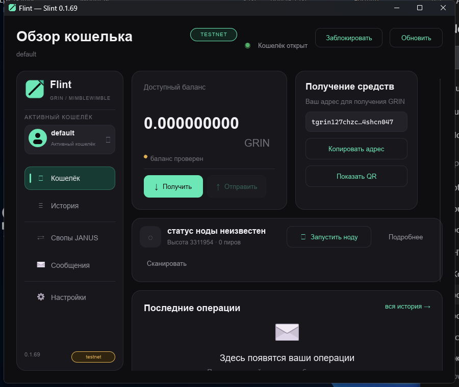

# Flint

Нативный desktop-кошелёк Grin (Mimblewimble) на Rust и Slint.
Версия workspace — **0.1.69**, Windows/MSVC, GPL-3.0-only.

**DEV BUILD: не аудирован, не для реальных средств. По умолчанию testnet.**
Последний принятый RC готов к внешним проверкам устройств; это не mainnet-релиз.
Фактические результаты, ограничения и идентичность сборки — [docs/STATUS.md](docs/STATUS.md).

## Возможности текущего RC

- Создание/открытие/блокировка, восстановление и backup; независимые профили.
- Embedded и управляемый grin-wallet RPC из закреплённого fork.
- Нода, полные scan, балансы/история и продолжение незавершённых операций.
- Slatepack send → receive → finalize → post → confirmation, безопасный retry/cancel.
- Шифрованные сообщения, контакты/история, relay и поддерживаемый direct onion.
- Общий Rust-контракт сумм/стадий/действий для desktop и отдельного iOS-проекта.

Janus остаётся demo. Публичный relay-сервис и фоновая Windows-нода не развёрнуты
этим проектом. Desktop-проверки не подтверждают готовность iOS/Android.



Иллюстрация интерфейса не заменяет приёмку конкретной версии/масштаба.
Дополнительные примеры: [сообщения](docs/assets/shots/flint-messenger-live.png),
[обмен Slatepack](docs/assets/shots/flint-slatepack-real.png).

## Структура

```text
crates/         Rust workspace: core, runtime, messenger, Slint, RPC, контракт, Janus
mobile/         самостоятельный iOS-проект и сохранённые мобильные backup-данные
third_party/    закреплённый grin-wallet/grin fork, patch и source provenance
resources/      native assets и проверяемые runtime-ресурсы поставки
lang/           канонический ru/en каталог для генератора
vendor/         зависимости текущей offline-сборки
tools/          CI, live-стенды, source/SBOM/упаковка, поиск
docs/           текущие статус/приёмка, архитектура, эксплуатация, безопасность, контракты
evidence/       минимальные свидетельства принятого RC
```

Рабочие кошельки, chain DB и секреты не являются исходниками или build cache.
Их пути/правила сохранения собраны в [docs/OPERATIONS.md](docs/OPERATIONS.md).

## Сборка и запуск

Нужны Rust **1.92+** (MSVC), Visual Studio Build Tools 2022/C++ и Windows SDK,
PowerShell 7. UI нативный Slint: WebView2/Node.js для самого кошелька не нужны.
Cargo.lock и .cargo/config.toml фиксируют текущий offline/vendor режим;
удаление vendor без восстановления источников ломает эту сборку.

```powershell
$env:TMP = $env:TEMP = 'C:\DHW\.tmp'
New-Item -ItemType Directory -Force $env:TMP | Out-Null
cargo build --release -p flint-slint
cargo run -p flint-slint -- --data C:\Flint-Testnet-Disposable
```

Длинные пути MSVC требуют короткого TMP/TEMP. Для portable нужны закреплённые
node, wallet fork, Tor, runtime DLL и их manifests в resources; комплект
проверяется packaging-скриптом. Управляемый wallet берётся из Flint fork,
не подменяется произвольным официальным exe.

```powershell
pwsh -File tools/ci.ps1
pwsh -File tools/package-slint.ps1
pwsh -File tools/release.ps1
```

CI проверяет исходники; package создаёт portable, release добавляет релизные
материалы. Новая сборка требует собственного BUILD-INFO, SHA-256, SBOM/source
и проверки запуска вне исходного дерева. Unsigned RC маркируется явно.
Установка/обновление/откат — [docs/OPERATIONS.md](docs/OPERATIONS.md).

`cargo test --workspace` не запускает ignored live-наборы. Для реальной цепи/Tor
нужны явно подготовленные testnet-кошельки/нода и соответствующие tools-скрипты;
ошибка конфигурации не считается успешно выполненным live-тестом.

## Документация

| Документ | Назначение |
|---|---|
| [AGENTS.md](AGENTS.md) | Единые правила работы, ADR/SDD и проверки |
| [docs/STATUS.md](docs/STATUS.md) | Единственный текущий статус и остаток |
| [docs/ACCEPTANCE.md](docs/ACCEPTANCE.md) | Приёмка RC, D-01…D-10, физический F-04 |
| [docs/ARCHITECTURE.md](docs/ARCHITECTURE.md) | Слои, backend, нода, решения и отложенные треки |
| [docs/OPERATIONS.md](docs/OPERATIONS.md) | Установка, данные, backup/restore, relay/Tor и уборка |
| [docs/SECURITY.md](docs/SECURITY.md) | Границы доверия, секреты, advisories и сохранённые finding IDs |
| [docs/DESIGN.md](docs/DESIGN.md) | Дизайн, ru/en и доступность |
| [docs/contracts/](docs/contracts/) | Messenger v1, transfer schema 1, receive recovery, seed envelope |
| [docs/DSH.md](docs/DSH.md) | Особенности DeepSeek Harness |
| [docs/mobile/README.md](docs/mobile/README.md) | Канон iOS и краткий Android-план |

Новые статусы не дублируются в отдельном плане/трекере/журнале. История кода и
решений — в Git; сырые временные логи не становятся постоянной документацией.

## Лицензия и поставка

[GPL-3.0-only](COPYING), [THIRD_PARTY_NOTICES.md](THIRD_PARTY_NOTICES.md).
Поставка включает corresponding source зависимостей/Slint и закреплённого fork,
требуемые notices, SBOM и контрольные суммы. Хэши не заменяют подпись релиза.
