# Slint — единственный UI

Статус: **Tauri удалён 2026-10-26; production-сборка — `flint-slint`.**

## Решение

Flint использует нативный Slint UI под **GPL-3.0-only** (см. `COPYING`).
Tauri-шелл удалён после переноса RPC, Tor и messenger в `flint-runtime`.

## Что сделано

- `crates/slint-ui` — бинарь `flint-slint`;
- `slint = 1.18.1`, `slint-build = 1.18.1`;
- MSRV **1.92**;
- окно 1280×860, минимум **900×760**; сайдбар 210–250 px с брендом Flint
  (знак «Складка», `ui/assets/flint-mark-48.png`) и одним переключателем профиля;
  lock-screen — центрированная карточка 510 px с высотой по содержимому, один
  переключатель профиля, пароль с зарезервированной ошибкой, широкая мятная
  «Разблокировать» и нижние действия; пункты меню 46 px/14 px с иконками и
  акцентной полосой;
  главный экран: баланс/получение/нода/история отдельными карточками, QR-модалка,
  короткий адрес и дружелюбное пустое состояние; кнопки primary/secondary/ghost с
  hover; основные подписи 12–16 px, суммы монет 32–44 px; `Ctrl+Z` после вставки
  восстанавливает предыдущее значение пароля/seed;
- «Сообщения» — две области: контакты и заблокированные адреса слева, переписка,
  получатель и composer справа; структурированные `MessageRow` (направление,
  текст, время), пустые состояния, диалоги «Добавить контакт» и «Восстановить
  историю»; armor `BEGINSLATEPACK. … ENDSLATEPACK.` распознаётся и предлагает
  «Обработать slatepack» с предзаполненным получением. Чекбокс «Обрабатывать
  слейтпаки автоматически» по умолчанию выключен; при включении автофинализация
  разрешена только для slatepack от сохранённых контактов;
  успешная отправка не изображается как доставка/прочтение;

- `cargo vendor` обновлён, offline-сборка работает;
- добавлен **`crates/runtime`** (`flint-runtime::WalletRuntime`) — UI-независимая
  сессия над `WalletService`;
- Slint использует runtime для status/open/summary/node/activity/scan;
- runtime также готов для settings/send/receive, но UI этих экранов ещё не
  подключён;
- локализация статического UI ru/en (`@tr`, встроенный каталог `en_US`), выбор языка
  в настройках применяется после перезапуска; справка восстановления — overlay;
  динамические сообщения — через `i18n.rs`, непереведённые получают generic-текст
  и лог — [LOCALIZATION.md](LOCALIZATION.md);
- Slint «Сканировать» реально вызывает `scan` с прогрессом по батчам;
- Slint send/receive: ручной обмен slatepack-ами через runtime:
  подготовка → slatepack/ответ → финализация;
- Slint settings: network (testnet/mainnet), profile, node URL, relay, min
  confirmations; запуск/остановка managed node; смена сети/профиля через runtime
  (с остановкой ноды и переоткрытием WalletService);
- профили: 3 последних открытых — крупными кнопками сверху, ниже полный список
  (ComboBox); переключение в пределах 5 минут переиспользует пароль из памяти, после
  5 минут без ввода мыши/клавиатуры кошелёк блокируется и кэш очищается;
  новое имя переключает на отдельный профиль и сразу открывает создание seed; выбор
  пустого профиля в списке также открывает создание. Переименования нет:
  новое имя — это новый профиль;
- wallet lifecycle в Slint: создание кошелька с одноразовым показом seed,
  восстановление из seed-фразы; UIA-проверка создания: seed и адрес показаны;
- безопасность в Slint: смена пароля, удаление кошелька с подтверждением имени,
  seed-envelope status, миграция legacy → envelope, отключение Argon2id и
  quarantine repair; «Показать seed» требует пароль, показывает фразу в read-only
  поле и не логирует/не копирует её автоматически;
- single-instance: Windows named mutex `Local\FlintWalletSingleInstance`; второй
  процесс завершается, первый остаётся;
- история: отдельный экран `activity(200)` с количеством операций;
- pending: список ожидающих операций, повторная отправка и отмена через runtime;
- scan можно отменить на границе батча; «Новый адрес» ротирует адрес и QR;
- клавиатура: Enter отправляет основные формы (разблокировка, создание, восстановление,
  отправка, настройки, смена пароля, удаление); в поле пароля есть кнопка «Вставить»,
  а кастомный перехват Ctrl+V убран — вставку обрабатывает сам LineEdit/TextEdit.
- clipboard: адрес, slatepack отправки и ответ приёма копируются через
  `arboard` (без image-фич);
- QR адреса в окне «Получить»: `qrcode` 0.14 → RGBA → Slint `Image`
  (screenshot `docs/assets/shots/slint-qr.png`);
- реальный `WalletService`:
  - `status_fast()` для первого кадра;
  - пароль → `open_wallet`;
  - `summary()` → баланс и адрес;
  - `node_info()` в фоне;
  - `activity(20)` → модель истории;
- lock screen: пароль, ошибка, кнопка «Разблокировать»;
- sidebar — настоящие кнопки, а не `Text`;
- при открытой модалке/локскрине фон скрыт из UI-дерева, поэтому Tab не уходит
  в невидимые кнопки;
- `flint-slint.exe` — **GUI-subsystem** (PE subsystem 2), консольного окна нет.

## Живость и оформление

- `slint::Timer` раз в 2 с обновляет статус ноды/скана и прогресс без полного
  snapshot; полный snapshot — только при переходе ноды в ready.
- QR пересобирается только при смене адреса (`qr-address`), а не на каждый
  refresh.
- Цвета/радиусы — `ui/theme.slint`; в `spike.slint` нет цветовых литералов.
- `ui/nav-button.slint` — active/hover навигация с UIA role=button.
- Окно resizable от 900×760; основной контент в `ScrollView`, модалки
  ограничены размером окна.
- Прогресс скана — анимированная полоса; embedded-скан можно поставить на
  паузу между батчами (RPC — только отмена).
- Предупреждения: свободное место < 2 ГиБ; Headers/Blocks — возможен большой
  сетевой трафик.
- Pending: loading/empty/error/unreadable; повреждённый файл, путь диагностики,
  «Повторить загрузку» и command-gate. `locked`/`prepared` — только «Отменить»;
  `finalizing`/`finalized_not_posted` — только «Повторить»;
  `failed_recoverable` — read-only («Обновить»), без auto cancel/publish;
  `posted` — только статус; нечитаемые id не проходят gate.
- Send: prepared snapshot (`slate_id`, recipient, amount, fee); правка адреса или
  суммы аннулирует prepare, «Завершить» использует только снимок.
- Settings: подсказка про полный rescan после копирования `data` или нескольких
  экземпляров кошелька.
- После полного rescan: если spendable изменился, показывается предупреждение
  с прежним и новым балансом — без молчаливой подмены цифры.

Pending: `locked` — только «Отменить»:

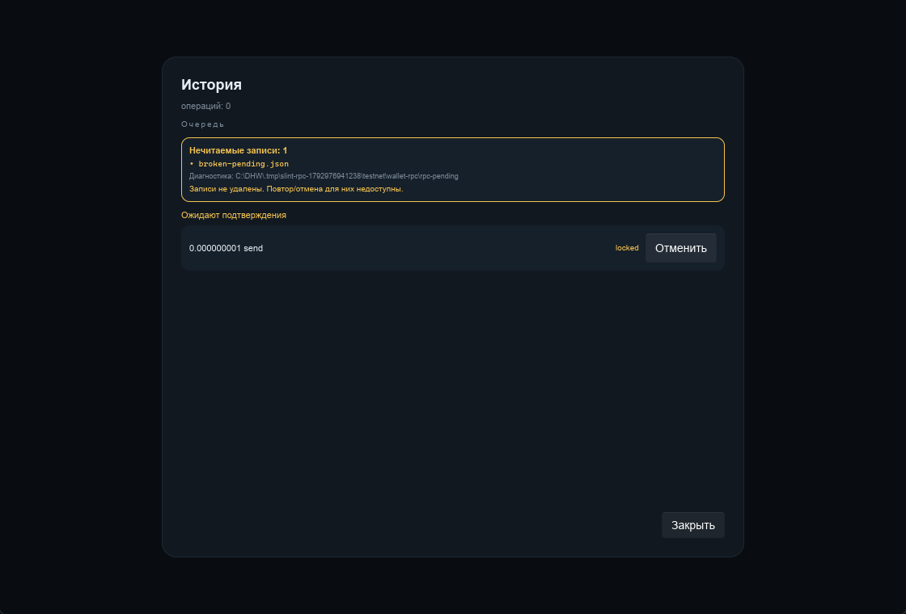

`finalized_not_posted` — только «Повторить»:

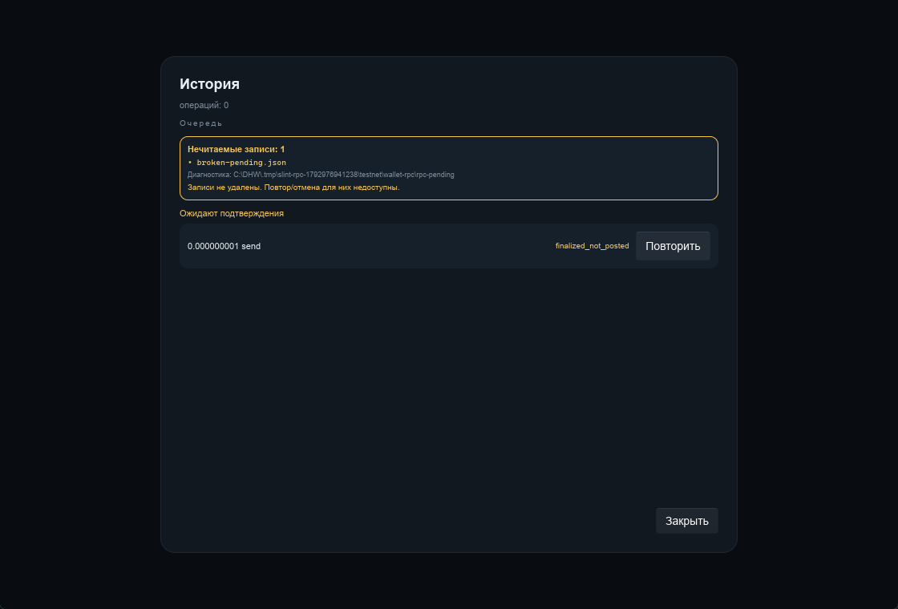

Полный сбой загрузки — красный блок и «Повторить загрузку»:

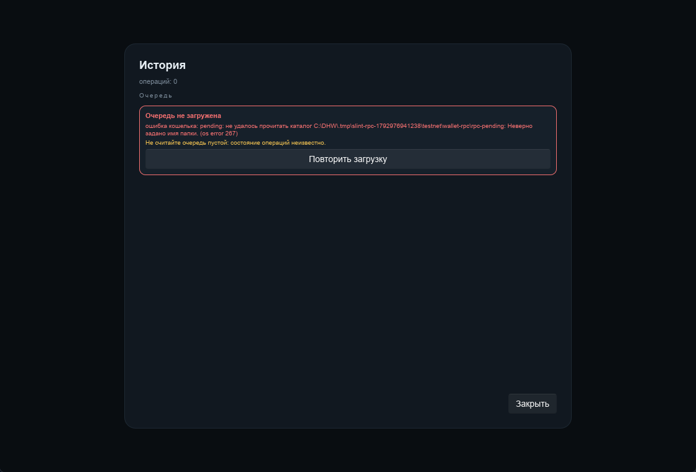

Funded testnet send на копии `dist/data`: 1 GRIN, комиссия 23 500 000 nano,
получатель принял, отправитель получил `Отправлено: dbcd23a3…`:

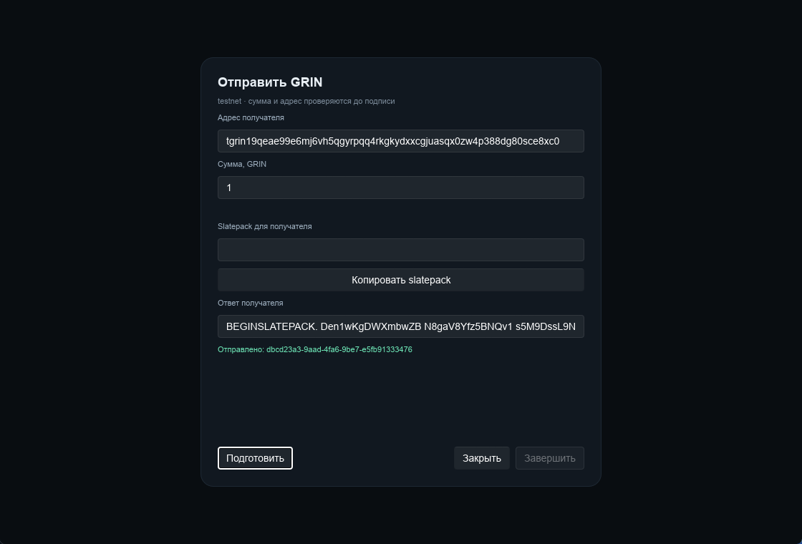

После prepare правка адреса аннулирует снимок и блокирует «Завершить»:

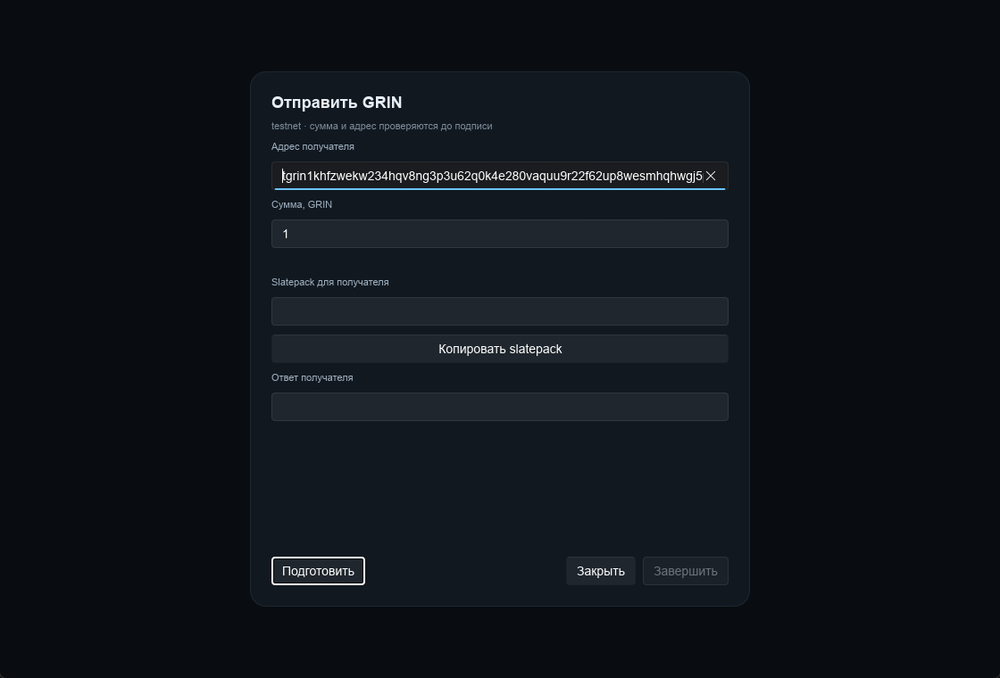

Настройки при 900×760: компактные отступы, модалка целиком в окне,
нижние «Безопасность/Закрыть/Сохранить» доступны:

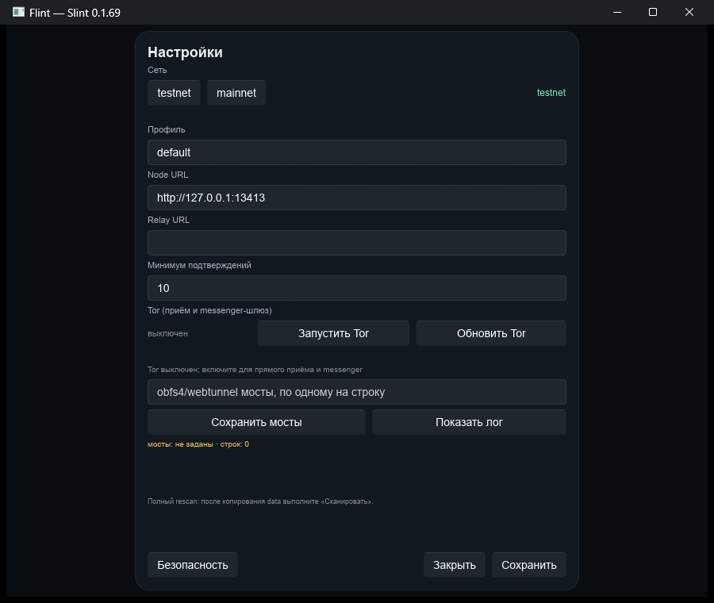

Масштаб 125% и 150% (`SLINT_SCALE_FACTOR`):

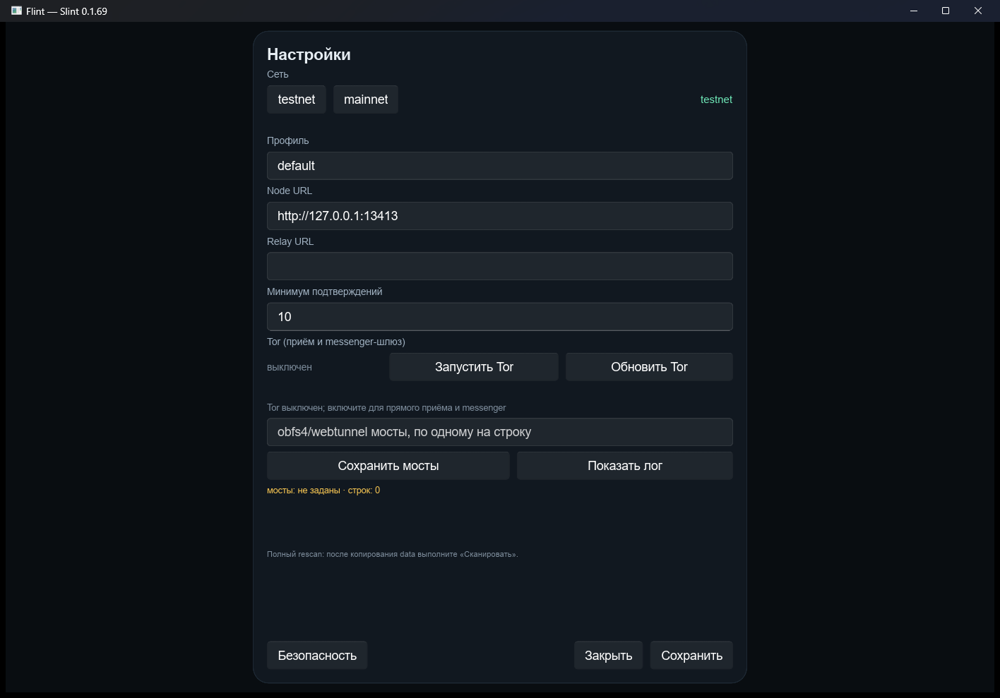

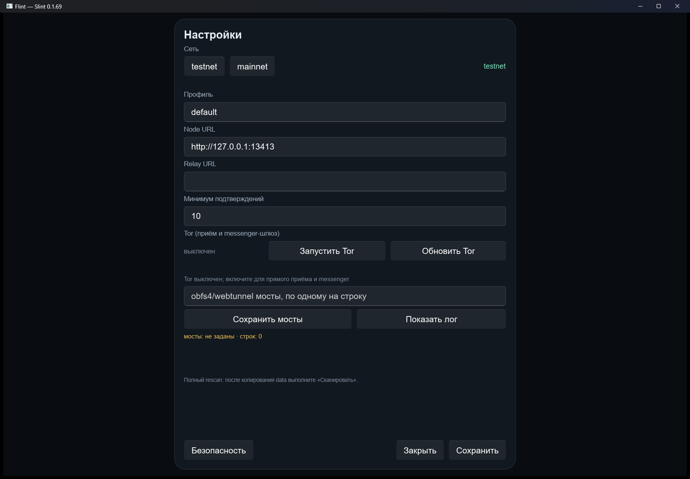

Запуск:

```powershell
cargo run -p flint-slint
cargo run -p flint-slint -- --data C:\path\to\data
```

## Portable preview

Собран release-бинарь `flint-slint`:

```powershell
cargo build --release -p flint-slint
```

- `target/release/flint-slint.exe` — 32 154 624 байт, PE subsystem 2;
- preview-пакет: `lastver/Flint-0.1.69-slint-preview.zip` (45 259 212 байт,
  SHA-256 `8A3A0273…D86526`);
- сборка пакета: `pwsh -File tools/package-slint.ps1`;
- пакет содержит managed node, selftest, COPYING, notices и README;
- RPC-режим (`--backend=grin-wallet`) входит вместе с
  `resources/wallet/grin-wallet.exe`, Tor — с `resources/tor/expert`; Slint
  Settings запускает/останавливает Tor, сохраняет мосты и показывает `tor.log`
  (UIA: onion, `bootstrap 100%`, `obfs4: клиент найден`);
- Slint-экран «Сообщения»: адрес, relay/direct и ключ истории, отправка,
  входящие, контакты (save/delete/history), blocked (block/unblock) и recovery
  старой истории по паролю;
- пароль: Enter и Ctrl+V (латиница и русская раскладка), состояние
  `проверяю пароль…`, сброс старой ошибки при новом вводе;
- QR: полный буфер с quiet zone по всем сторонам;
- нода: stop/start без `ERROR_INVALID_HANDLE` (stdin не наследуется).

## Скриншоты
Lock screen с реальным кошельком:

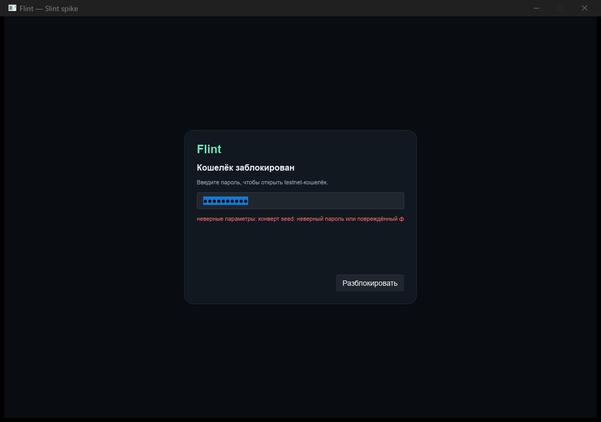

После разблокировки: реальный адрес, баланс, нода и пустая история:

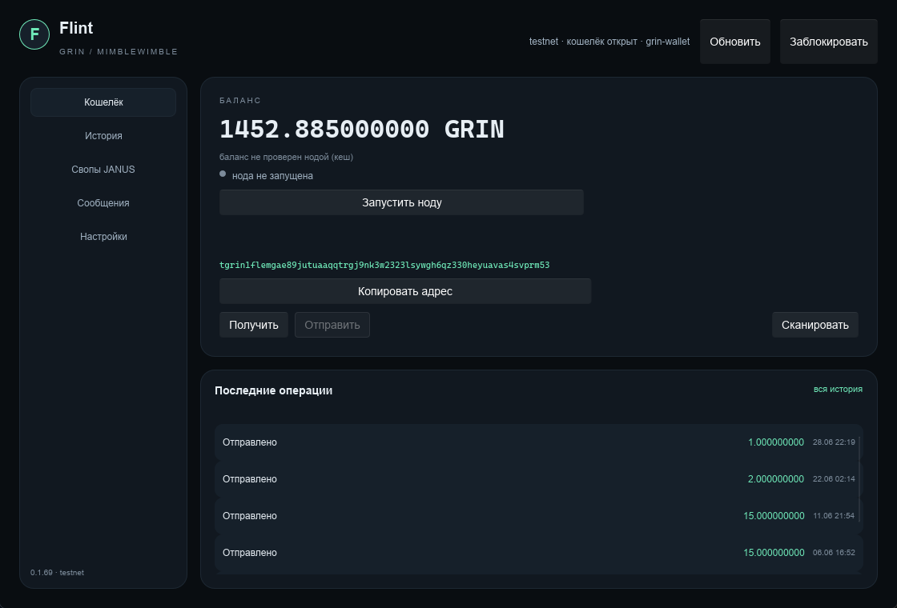

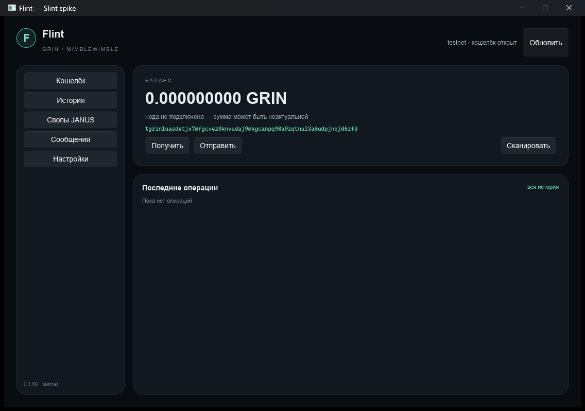

Phase 0 visual modal:

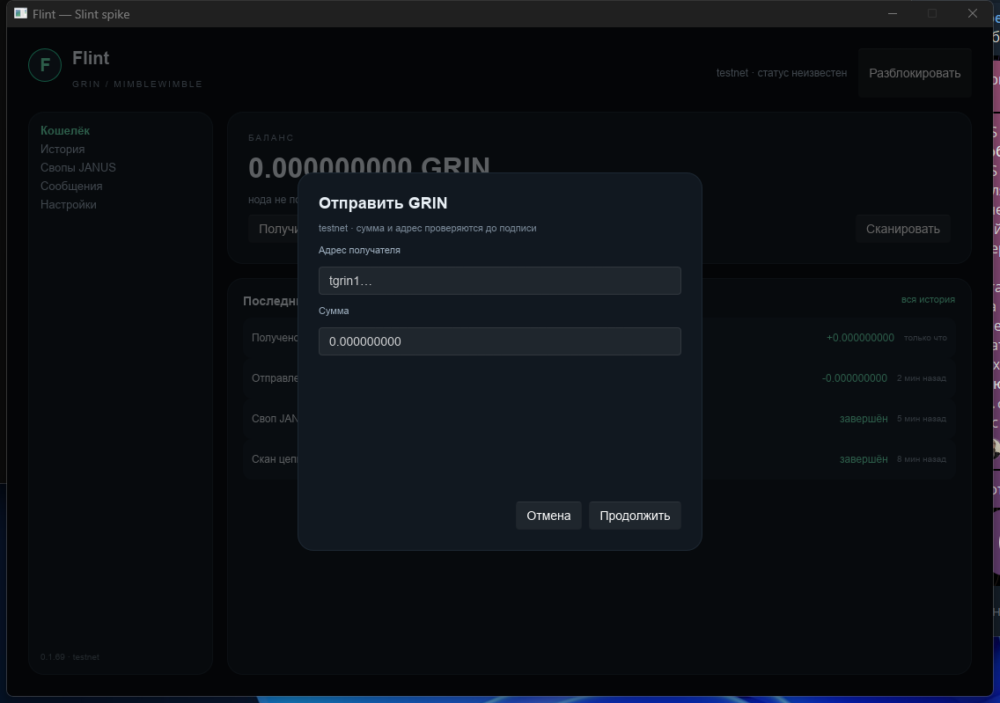

«Получить GRIN» после исправления: QR и action-row не перекрываются, показана
синхронизация ноды (высота/фаза/пиры):

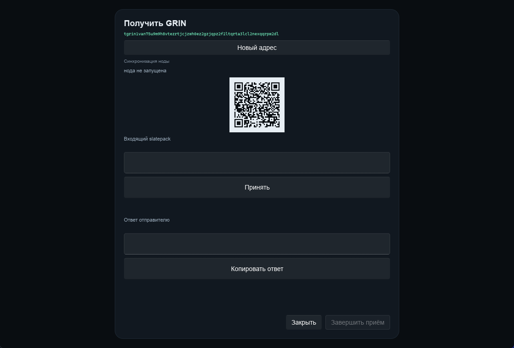

## Accessibility

Проверено через Windows UI Automation (NVDA на машине нет):

- lock screen: в UIA-дереве только `Edit "Пароль"` и `Button
  "Разблокировать"`; фоновые контролы скрыты;
- после разблокировки: кнопки sidebar, «Получить», «Отправить», «Сканировать»,
  список «Последние операции»;
- поля имеют `accessible-label`; кнопки — имена;
- Tab-порядок в Phase 0 был: 4 кнопки → адрес → сумма → «Отмена» →
  «Продолжить»;
- список читается как `ControlType.List` с именем.

Не проверено:

- реальный NVDA/Narrator;
- 200% DPI;
- IME/кириллица;
- 1 000+ строк истории;
- фокус после закрытия модалки;
- длинные адреса и перенос строк.

Проверено дополнительно: Settings при 900×760, scale 125%/150%,
перенос окна на второй монитор.

## Что ещё не сделано

- runtime покрывает status/open/summary/node/activity/scan/settings/send/receive
  и swaps API; в Slint есть экран борда, «Взять» и «Симулировать» (refund UI
  ещё нет);
- UIA-проверка борда: `local-demo-board · 3 офферов`, три `XMR → GRIN`,
  курсы и stamps читаются; фон скрыт. UIA-проверка simulate:
  `симуляция: завершён · swap_…`.
- ручная приёмка NVDA/IME; DPI 125/150 и 900×760 проверены, чистая Windows
  без UCRT/VC++ — только имитация + bundled runtime;
- замена UIA-скриптов на Slint testing/AT-SPI в CI;
- подпись release-сертификатом.

## Следующие фазы

1. **Phase 2 — выполнено**: RPC/scan/send/receive/settings/Tor/messenger в
   runtime; UIA из source и preview.
2. **Phase 3 — выполнено**: паритет send/receive, swaps, messenger, settings, Tor.
3. **Phase 4 — выполнено**: упаковка без WebView2, удаление Tauri, CI на Slint.
   Осталась ручная приёмка NVDA/IME и фактическая чистая Windows.

## GPL-обязательства

- исходники Flint — `COPYING`, `dist/Flint-<version>-source.zip`;
- исходники Slint — `vendor/slint*` и `vendor/i-slint*` в source archive;
- при распространении бинарника source archive должен сопровождать его;
- если проект станет проприетарным — нужна коммерческая лицензия Slint.
